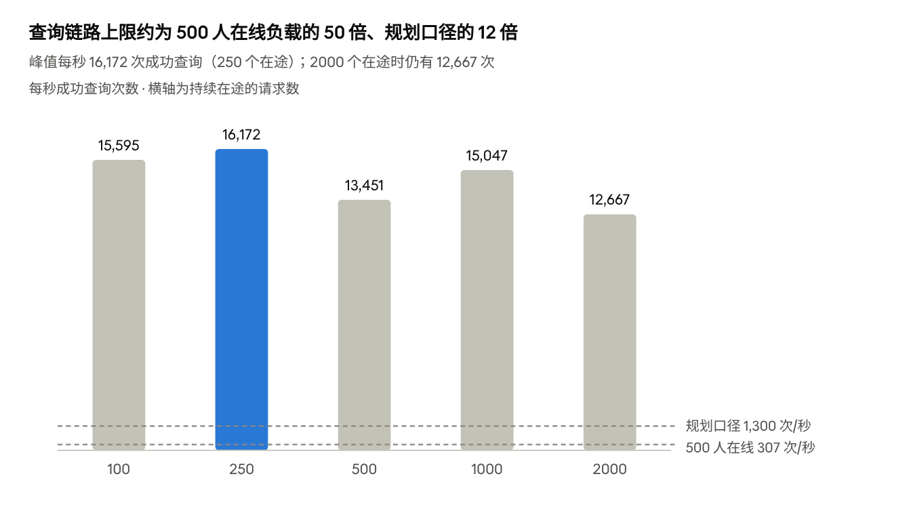
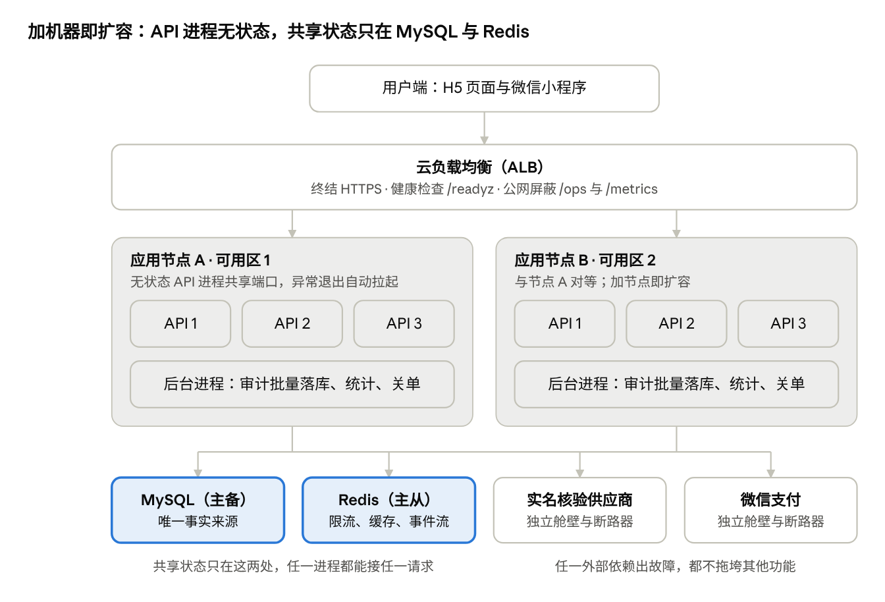
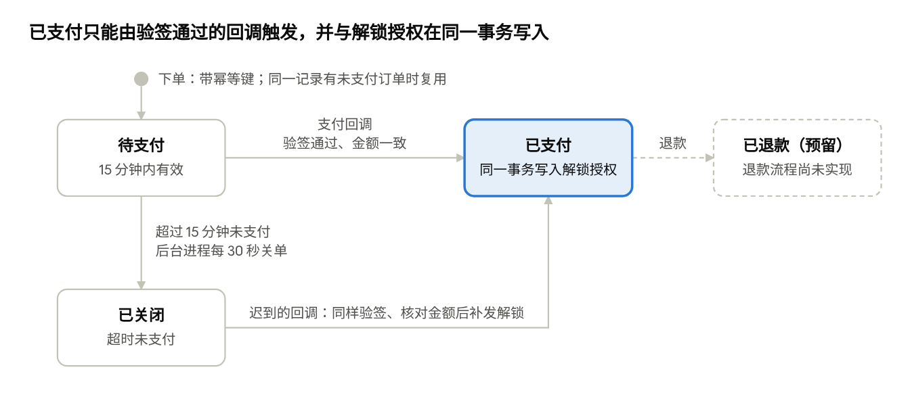

# 个人债权信息查询平台 · 技术开发文档（V2 架构）

> 团队版，2026-11-14。三张图在 design/img/。

## 1 结论与文档信息

重构后的 V2 架构在同一台机器上通过了"500 人同时使用"的全部验收项。旧版在正常负载下可用，但过载即雪崩、故障不自愈，并且查询接口可被遍历。

### 一页纸结论

1. **旧版没有余量，也没有保护。** 500 人正常操作时它能用；但 500 个请求持续在途时成功率只有 4.8%。根因是本机网关把个别连接错误放大成了全站 503。
2. **旧版有结构性安全漏洞。** 任意"姓名 + 证件尾号"都能直接检索，单个会话 15 秒遍历 1 万个尾号，全部放行。
3. **V2 按接入、逻辑、数据、异步四层重构。** 每个下游都有并发闸门、超时和断路器；过载时排队或礼貌拒绝，不雪崩。查询只能查已核验的本人，遍历在结构上不可能发生。
4. **实测通过。** 500 人稳态 5 分钟约 1.5 万次完整旅程全部成功，查询 P95 为 2.5 毫秒；4 倍过载零硬失败；8 类故障演练的旅程成功率均为 100%，每一项都与数据库逐条对账一致（第 15 节）。
5. **还没验证的四件事**是试点前的必做项：真实实名核验与微信支付、微信真机、阿里云环境、容器构建。告警实测、审计对账脚本等其余待办一并列在第 17 节。

### 文档信息

| 项目 | 内容 |
| --- | --- |
| 版本 | V2.0 评审稿 |
| 代码 | 仓库 3x-debt-query-demo，分支 arch-v2，尚未合入 main |
| 依据 | 项目 PRD（实施版 V0.3）与需求确认 |
| 适用范围 | Demo 与首期试点的技术实现、部署、测试、运维 |
| 数据 | 全部为程序生成的虚构数据，证件号以 99 开头，不可能与真实身份证号重合 |
| 测试环境 | Apple M4（10 核）、16 GB 内存、macOS；数据库、缓存、应用、第三方模拟器和压测端同机运行 |
| 评审重点 | 第 5 节容量口径、第 10 节保护阈值、第 11 节核验强度、第 17 节试点前必做项 |

## 2 背景、目标与验收口径

本期目标是让 500 人同时走完"核验、查询、解锁、预约"全流程而不出错；过载或依赖故障时，系统表现可预期。

### 2.1 需求约束

| 约束 | 对技术的影响 |
| --- | --- |
| 只能查本人，不能下载 | 查询接口不接受任何身份参数；不提供批量导出 |
| 本人核验用身份证 | 首期为"姓名 + 证件号"二要素；强度不足的风险见第 11 节 |
| 基础信息免费，完整 6 项 9.9 元 | 订单状态机、回调验签、下单与回调幂等 |
| 24 小时可查，人工工作时间回复 | 查询全自动；人工预约进队列 |
| 按 500 人验收，1000 人按多负载做架构 | 无状态横向扩展；压测到 2000 个虚拟用户 |
| 部署在阿里云云服务器 | 生产拓扑见第 13 节 |
| 加密保存，不删除 | 证件号只存盲索引与掩码；保存期限须法务确认 |
| 台账实时更新 | 批次导入 + 数据版本号，变更秒级生效 |

### 2.2 目标与非目标

目标：

- 500 人同时使用时，完整旅程成功率 ≥ 99.9%，查询接口 P95 ≤ 100 毫秒。
- 超出容量时柔性降级：排队或提示稍后重试，不出现大面积报错。
- 任一进程、缓存或外部供应商故障时，不给出错误结果。数据库故障只会显示"暂不可用"，绝不显示"无记录"。
- 每次查询都有审计记录，不丢不重；每笔支付都能对账。
- 任何人都不能通过接口查到别人的信息。

非目标：

- 电子签、公证、还款与案件派单，由处置方现有流程承担。
- 机构招募与营销内容生产，由催收智脑行业模板承担。
- 真实个人数据的采集与入库，须在获批的受控环境另行实施。
- 多地域、多 SET 部署，当前规模不需要（扩展路径见第 4 节）。

### 2.3 "500 人同时使用"的三种口径

三种口径的压力相差 15 倍，验收必须写明用的是哪一种。旧版压测只覆盖了第一种，且每步思考 2–4 秒，实际同时在途的请求只有 4–6 个。

| 口径 | 含义 | 本机实测等效负载 | 对应验收阶段 |
| --- | --- | --- | --- |
| 在线并发 | 500 人同时在用，每步思考 1–3 秒 | 约 300 次/秒 | T1 稳态 |
| 同时发起 | 500 人在同一秒进入并走完全程 | 1.3 秒内约 3,000 次 | T2 洪峰 |
| 持续在途 | 任一时刻都有 500 个请求在处理 | 约 4,500 次/秒 | T3 高压 |

另加 T4、T5 两个过载阶段（1000、2000 个无间歇的虚拟用户）和 T6 恢复阶段，验证超量时不雪崩、退潮后能复原。

### 2.4 服务等级目标

| 指标 | 目标 | 说明 |
| --- | --- | --- |
| 可用性（按月） | ≥ 99.5% | PRD 建议值，维护窗口另计 |
| 查询接口 P95 | ≤ 100 毫秒 | 500 人在线时；不含实名核验 |
| 本人核验 P95（含排队） | ≤ 1.5 秒 | 主要取决于核验供应商 |
| 支付到账确认 P95 | ≤ 2 秒 | 从支付成功到用户看到"已支付" |
| 审计落库延迟 | ≤ 5 秒 | 积压超过 1000 条告警 |
| 恢复点 RPO / 恢复时间 RTO | ≤ 5 分钟 / ≤ 30 分钟 | 建议值，依赖云数据库高可用版。PRD 原建议为 24 小时 / 8 小时，待业务确认 |

## 3 现状诊断：V1 的八个问题

V1 在"500 人正常操作"下并不会挂，问题在于：余量不可知、过载即雪崩、故障不自愈、接口可被遍历。以下证据均为重构前在同一台机器上实测，原始数据在 bench/reports/v1-baseline.json。

| # | 问题 | 同机实测证据 | V2 对策 |
| --- | --- | --- | --- |
| 1 | 过载被放大成全站故障。网关连接池空闲上限 48，超出的连接用完即关；任一上游连接出错，该实例就被摘除约 1 秒，两个实例同时被摘时所有请求直接 503 | 500 个请求持续在途：成功率 4.76%，148.9 万次请求中 141.8 万次是网关 503。8 秒内 TIME\_WAIT 套接字累积约 1.19 万个，本机临时端口共 16,384 个 | 去掉自写网关，由负载均衡与进程管理器分发；长连接复用；过载在入口及早拒绝（第 10 节） |
| 2 | 单实例过载后吞吐崩塌，没有"排不上就拒绝" | 直连单个 API：在途 500 时每秒成功 8,439 次；在途 1000 时只剩 795 次（成功率 1.39%），P50 从 37 毫秒涨到 689 毫秒 | 每个依赖设并发、排队、等待三重上限，排队快满即拒绝；4 倍过载仍保留 78% 峰值吞吐 |
| 3 | 每次查询同步写一行审计（随机 UUID 主键），数据越多越慢 | 250 在途直连时出现过一次全体请求挂起超过 10 秒（服务端 11 次 PROTOCOL\_SEQUENCE\_TIMEOUT），复测采样时活跃线程多停在"等待提交落盘"。审计表 40.7 万行时数据加索引 142 MB，超过默认 128 MB 缓冲池 | 审计先进事件流，后台每 500 条一个事务批量落库；趋势递增主键 |
| 4 | 依赖故障时请求挂起白等，且就绪检查依赖数据库，数据库一卡所有实例同时被摘 | 数据库停顿 6 秒（200 人负载）：成功率 97.9%，P99 5.8 秒；失败中 171 次来自网关"全部实例不健康" | 断路器快速失败；就绪检查只反映本实例状态；提示"暂不可用"而非"无记录" |
| 5 | 进程死了不会自己起来 | 强杀一个 API 实例后，剩余实例接管了流量（99.99%），但被杀实例没有被拉起，容量永久减半 | 进程管理器自动拉起（实测 0.6 秒），支持滚动重启 |
| 6 | 查询接口可被遍历：公告候选检索接受任意"姓名 + 证件末四位"，无频率限制 | 单个会话 50 并发，15 秒请求 1 万次，全部放行 | 查询不接受身份参数，只查已核验的本人；核验有三重限流 |
| 7 | 验收口径过松，测不出余量 | 旧压测"500 会话、每步思考 2–4 秒"期间，同时在途的请求峰值只有 4–6 个，每秒约 170 次 | 三种口径 + 两档过载 + 恢复，每阶段与数据库对账（第 15 节） |
| 8 | 缺少运营必需的基础能力 | 无限流、无监控指标与告警、无动态开关；解锁无订单与支付回调；核验是"选择演示身份"；导入无校验与撤销 | 逐项补齐，见第 7、12 节 |

这些问题来自连接管理、同步写、依赖无隔离和接口设计，调参数解决不了，所以选择重构。第 3 项的挂起只出现过一次，根因未完全定位，但同步提交是所有在途请求的共同等待点。

## 4 设计原则：腾讯海量服务之道的落地

本系统按腾讯"海量服务之道"的 2 个价值观、7 个技术手段、4 个意识逐条对照设计；13 条中 12 条已落地并有测试验证，"分 SET 部署"因规模不需要而只给扩展路径。

| 理念 | 要求 | 本系统的做法 | 验证 |
| --- | --- | --- | --- |
| **有损服务**（价值观） | 细分场景，牺牲部分一致性与完整性，换取核心功能基本可用 | 统计计数失败直接丢弃；Redis 故障时限流退化为进程内近似值；核验繁忙时排队。审计与支付不在"可损"之列，审计走事件流 + 备用通道 + 拒绝兜底 | 演练 D4 Redis 假死 |
| **动态运营**（价值观） | 小步快跑，快速求证用户猜想 | 4 个动态开关即时广播到全部进程；数据导入与撤销通过数据版本号让缓存秒级失效；渠道参数进入业务漏斗 | 接口测试"动态开关"；导入与撤销实操 |
| **容灾** | 热备、异地部署、程序异常自动拉起、流控防雪崩 | 进程级：管理器自动拉起，连续崩溃退避；节点级：至少 2 台、跨可用区；数据级：云数据库主备 + Redis 每秒落盘；外部依赖：断路器 | 演练 D2、D3、D5 |
| **过载保护** | 轻重分离；及早拒绝（前端保护后端，后端不信任前端）；量力而为（70% 预警、90% 启动）；动态调节 | 审计、统计、关单移到后台进程；入口按在途数、事件循环延迟、数据库排队三个信号拒绝；每个依赖独立舱壁；前端按服务端给的等待时间退避重试；容量 70% 预警 | 验收 T4、T5 过载 |
| **负载均衡** | 合理分配请求；有了负载均衡仍需过载保护 | 节点间用云负载均衡，节点内多进程共享端口；就绪检查只反映本实例，数据库抖动不会把全部实例同时摘掉 | 运行大盘"实例负载" |
| **柔性可用** | 重点接口重点保障，次要接口有损，紧急时可降级 | 支付回调与订单状态是关键请求，另有 200 个在途名额，过载时最后才被拒；解锁、预约可单独关闭而不影响查询 | 演练 D8 支付宕机 |
| **分 SET 部署** | 自治的服务单元，SET 间窄带通信，单 SET 故障仍提供基础服务 | 未实施。一个 SET（2 台应用 + 1 套数据库）的容量已是需求的十倍以上。扩展时按渠道或地域分 SET，SET 内自带应用、数据库、Redis，由用户假名编号决定路由 | 不适用 |
| **灰度发布** | 按特性、按对象分批发布 | 进程级滚动重启（新进程就绪后旧进程排空退出）；功能用开关灰度；渠道参数可按渠道放量 | 演练 D1 滚动发布 |
| **立体监控** | 接入层、逻辑层、数据层，从资源到用户体验；告警少而准 | 运行大盘覆盖活跃用户、吞吐、分位耗时、实例、依赖、业务漏斗；/metrics 接 Prometheus；10 条告警，每条写明处置动作 | 第 12 节 |
| **大系统小做**（意识） | 化大为小，减少耦合，可单独发布 | 10 个业务模块 + 基础设施层 + 外部依赖适配层；外部供应商可整体替换 | 代码目录（附录） |
| **先扛住再优化**（意识） | 先保证业务可用，再做复杂优化 | 先上排队、限流、降级、自动拉起，再按压测结果调优。例：容量摸高首轮发现 2000 在途时断路器误跳闸，有效吞吐只剩 1,586 次/秒；把"过载"和"故障"分开计数后，同一脚本恢复到 11,408 次/秒 | 容量摸高 |
| **干干净净**（意识） | 产品用减法，架构层次清晰，运营环境有序 | 配置唯一入口；统一错误码；日志只含内部编号；本机环境用私有数据目录，不碰系统已有服务；旧版代码已移除 | 代码评审 |
| **边重构边生活**（意识） | 有勇气重构，在服务中持续演进 | 不改 PRD 范围的前提下重构；旧版基线可复现；新旧行为差异逐项列出 | 附录 V1→V2 对照 |

来源：[解密腾讯海量服务之道（腾讯云开发者社区）](https://cloud.tencent.com/developer/article/1031501)。公开资料中七个技术手段有两种写法（另一版含"全网调度""自动部署"），本文按腾讯云社区版本对照。

## 5 容量评估

500 人在线约产生每秒 300 次请求；单机 4 个进程的查询链路上限实测为每秒 1.6 万次，余量在 50 倍以上。真正的瓶颈是实名核验供应商的配额与单价。

### 5.1 访问模型

| 参数 | 取值 | 依据 |
| --- | --- | --- |
| 每次完整旅程的请求数 | 平均 6.5 次 | 进入、核验、查询、预约、查看预约各 1 次；约 20% 用户下单、支付、轮询、看详情；一半用户撤回预约 |
| 每步思考时间 | 1–3 秒均匀分布 | 压测假设；真实用户通常更慢，结果偏保守 |
| 单个在线用户的请求率 | 约 0.65 次/秒 | 6.5 次 ÷（旅程约 7.9 秒 + 旅程间隔约 2 秒） |
| 500 人在线 | 约 300 次/秒 | 与验收 T1 实测一致 |
| 洪峰 | 约 2,200 次/秒，持续 1–2 秒 | 500 人同一时刻进入，验收 T2 |
| 规划口径 | 约 1,300 次/秒 | 1000 人在线 × 2 倍余量 |

每次查询还会产生一行审计日志（约 200 字节）和一行审计记录（约 200 字节），存储与日志成本见第 8 节。

### 5.2 各环节的成本与瓶颈

| 环节 | 每次请求的成本 | 限额或实测 | 判断 |
| --- | --- | --- | --- |
| 接入与鉴权 | 签名令牌在本进程校验，不访问任何存储 | 随进程数线性扩展 | 不是瓶颈 |
| 本人核验 | 1 次外部调用 + 1 次缓存读写；同一人 24 小时内不重复调用 | 每进程并发 40，排队 400，最多等 3 秒 | **第一瓶颈**：取决于供应商配额与单价 |
| 查询 | 1–3 次索引点查 + 1 次缓存写 | 见 5.3 | 数据库连接数（每进程 10 个） |
| 审计 | 1 次事件流写入；后台每 500 条一个事务落库 | 压测结束后积压清空用时 < 10 毫秒 | 不是瓶颈 |
| 下单与支付回调 | 2–4 次写入 + 1 次外部调用 | 支付通道并发 30 | 取决于支付渠道 |

### 5.3 查询链路的实测上限

做法：另起一组专用进程（4 个 API 进程），放开查询限流、关闭结果缓存，让每次查询都真实打到数据库并写审计流水；从 100 到 2000 个不间断查询的虚拟用户逐级加压，每级 15 秒。



*数据：bench/reports/v2-capacity.json · 5 级、每级 15 秒 · 同一台 10 核笔记本*

吞吐在 250 个在途时达到峰值，此后没有随在途数增加而崩塌；多出来的请求只是排队，所以耗时随在途数上升。2000 个在途时有 6,900 次被保护机制拒绝（排队或入口保护，客户端按建议时间重试），硬失败为 0。

| 持续在途 | P50（毫秒） | P95（毫秒） | P99（毫秒） | 预期内拒绝 | 硬失败 |
| --- | --- | --- | --- | --- | --- |
| 100 | 5.4 | 14.0 | 22.3 | 0 | 0 |
| 250 | 12.9 | 34.2 | 49.7 | 0 | 0 |
| 500 | 28.1 | 90.5 | 137.7 | 0 | 0 |
| 1000 | 50.0 | 157.6 | 230.5 | 0 | 0 |
| 2000 | 81.7 | 263.0 | 442.2 | 6,900 | 0 |

压测端与被测端同机运行、争抢 CPU。吞吐不随在途数单调变化（500 档低于 1000 档），推测主要来自这一点。同机多次摸高的峰值在每秒 1.6 万到 2.3 万次之间，这里取最后一次（偏保守）。

### 5.4 生产规格测算

按"容量 70% 预警、90% 启动保护"和"单台故障时另一台能扛住全部常态负载"两条规则测算。以下为首期试点建议值，上线前须用同一套脚本在云上复测，以云上实测为准。

| 组件 | 建议规格 | 依据 |
| --- | --- | --- |
| 应用节点 | 2 台 4 核 8 GB，分属两个可用区；每台 3 个 API 进程 + 1 个后台进程 | 本机 4 个 API 进程在 T3 中以约 4,500 次/秒零失败；单台即可覆盖 1,300 次/秒的规划口径 |
| 负载均衡 | 应用型负载均衡（ALB），终结 HTTPS | 小程序只访问已备案的 HTTPS 合法域名 |
| 数据库 | 云数据库 MySQL 8.0 高可用版，2 核 4 GB 起 | 连接数 2 台 × 4 进程 × 10 = 80；全部数据加索引目前约 0.3 GB，可全部放进缓冲池 |
| Redis | 主从版 1 GB，开启持久化 | 只存短期数据（限流、缓存、回执、事件流），全部带过期时间 |
| 核验供应商 | 并发配额 ≥ 100，按投放计划设每日预算 | 每进程并发上限 = 供应商配额 ÷ 全部 API 进程数，配额 100、6 个进程即每进程 16 |

## 6 总体架构

V2 分接入、逻辑、数据、异步四层。API 进程不保存会话状态，共享状态只放在 MySQL 与 Redis；任意进程、任意节点都能处理任意请求，所以加机器即扩容。



*图：生产部署拓扑 · 2 台应用节点、4 个共享依赖*

图中是生产形态（第 13 节）。本机开发时，同一台机器上运行 4 个 API 进程和 1 个后台进程，MySQL 与 Redis 为项目私有实例。

### 6.1 分层与职责

| 层 | 组成 | 职责 | 扩容方式 |
| --- | --- | --- | --- |
| 接入层 | 云负载均衡；每台节点一个进程管理器，N 个 API 进程共享同一端口 | 分发请求、健康检查；入口过载保护；令牌鉴权；参数校验 | 加节点、加进程 |
| 逻辑层 | 10 个业务模块；实名核验、支付两个外部依赖适配器 | 业务规则；每个外部依赖有独立的舱壁与断路器 | 随 API 进程一起扩 |
| 数据层 | MySQL（唯一事实来源）；Redis（限流、缓存、查询回执、事件流、指标快照、开关、节点号租约） | 持久化与跨进程共享状态 | 云数据库升配或加只读实例；Redis 升配 |
| 异步层 | 每台节点 1 个后台进程 | 审计批量落库、统计同步、超时订单关闭 | 多节点时由消费组自动分摊 |

### 6.2 一次查询经过的环节

1. 负载均衡把请求转给某台节点，由其中一个 API 进程接收。
2. 准入：在途请求数、事件循环延迟、数据库排队三个信号任一超限，就地返回"繁忙，请稍后重试"。
3. 鉴权：在本进程校验令牌签名，不访问任何存储。
4. 限流：Redis 令牌桶，每人每分钟 10 次；Redis 不可用时退化为进程内近似值。
5. 结果缓存：缓存键带数据版本号，有效 30 秒；命中则跳过数据库。
6. 查库：经数据库舱壁与断路器，按"台账 → 转让记录 → 公告候选"的顺序做 1–3 次索引点查。
7. 审计：查询回执与审计事件一次往返写入 Redis，由后台进程批量落库（第 7.4 节）。
8. 结果含转让记录时，实时读取解锁状态（不进缓存），然后返回。

### 6.3 进程模型

- 进程管理器（src/supervisor.mjs）拉起 N 个 API 进程和 1 个后台进程。任一子进程异常退出都会被自动拉起，连续崩溃时退避重试；收到 SIGHUP 时滚动重启（第 14 节）。
- API 进程是无状态的：令牌自带签名、可独立校验，共享状态都在 Redis 与 MySQL。这是横向扩展的前提。
- 后台进程以消费组读取事件流，多节点时自动分摊。它退出不影响查询，未处理的事件留在事件流里，拉起后补齐（演练 D3）。

### 6.4 技术选型

| 组件 | 选型 | 理由 |
| --- | --- | --- |
| 运行时 | Node.js 22 及以上（实测用 24），ES 模块 | 业务以 I/O 为主；单进程事件循环加多进程，用满多核 |
| Web 框架 | Fastify 5.12.8 | 吞吐高；用 JSON Schema 声明式校验参数，拒绝多余字段 |
| MySQL 驱动 | mysql2 3.24.6 | 连接池、预编译语句 |
| Redis 客户端 | ioredis 6.0.0 | 管道、Lua 脚本（原子限流）、发布订阅 |
| 前端 | 原生 ES 模块；小程序原生框架 | 无构建步骤，部署即静态文件 |

运行时只有 3 个直接依赖，版本全部锁定，供应链面小、便于审计。

## 7 关键链路设计

每条链路都回答三个问题：怎么防滥用、依赖故障时怎么表现、怎么保证不丢不重。

### 7.1 会话与身份

- 进入页面先领匿名会话（1 小时有效），用于渠道归因和核验前的限流。小程序正式环境应绑定 wx.login 换取的 openid。
- 核验通过后签发"已核验"令牌（30 分钟），内含用户假名编号、两个盲索引、姓名与证件号掩码，不含任何明文个人信息。
- 令牌是无状态的带密钥签名，任何进程都能独立校验，不依赖 Redis 或数据库。这是横向扩展的前提。
- 取舍：令牌载荷可被持有人解码（只有掩码与盲索引）。若评审要求不可解码，可换成服务端会话，代价是每次请求多一次 Redis 读。

### 7.2 本人核验

这是全链路最慢、最贵、最易被滥用的一步，按顺序经过七道关。

1. 参数校验：已同意且是当前文本版本；姓名 2–20 个汉字；证件号通过 GB 11643 校验码。演示环境只接受 99 开头的虚构证件号。
2. 第一层限流：同一会话每 10 分钟 5 次，同一来源 IP 每 10 分钟 60 次。
3. 查结果缓存：一致的结果 24 小时、不一致的结果 10 分钟内不重复调用供应商。
4. 第二层限流，只管真正调用供应商的请求：同一证件号每天 10 次；同时扣减每日核验预算（默认 20 万次，用完即停）。
5. 调用供应商：每进程并发 40、排队 400、最多等 3 秒，单次超时 2.5 秒；近期失败过半即断路 3 秒。排不上队时告诉用户"正在排队"并给出建议等待时间，前端自动重试。
6. 写授权记录（按"会话 + 本人 + 文本版本"去重，超时重试不会写出两条），再签发已核验令牌。
7. 因系统自身原因失败（排队超时、供应商故障、数据库不可用）时，退还第 2、4 步扣掉的频率额度与预算。否则用户按提示重试几次就会被自己的限流挡住。

### 7.3 查询

- 接口不接受姓名、证件号等任何参数，身份完全来自令牌。替别人查在结构上不可能发生。
- 匹配顺序：有效授权台账 → 已核实转让记录 → 脱敏公告候选 → 无记录。委托到期的台账不会命中。
- 公告候选只给"待人工核实"的结论，不返回明细；两条及以上记为同名同尾号冲突，不任选其一。
- 结果缓存 30 秒，缓存键带数据版本号：同一人刷新、连点不再打数据库，导入或撤销批次后秒级失效。解锁状态不进缓存，每次实时读取。
- 每人每分钟最多 10 次。
- 数据库排队满、断路、超时，一律返回"查询暂不可用"，绝不返回"无记录"。

### 7.4 审计：一条不丢，也不拖慢查询

1. 主通道：查询回执与审计事件用一次往返写入 Redis，回执保留 24 小时，事件进事件流。
2. 后台进程以消费组读取，每 500 条一个事务写库；写成功才确认并删除事件。主键即查询编号，重复投递不会产生重复行。
3. 备用通道：Redis 不可用或事件流超过 200 万条时，事件暂存在本进程，每 250 毫秒直接批量写库。
4. 兜底：暂存超过 2 万条就拒绝新查询。宁可暂停服务，也不产生没有审计的查询。
5. 对账：每次查询同时输出一行审计日志，可与数据库逐条核对。消费者异常退出后，其未确认的事件 30 秒后由其他消费者接管。

### 7.5 付费解锁

转让记录的日期与金额免费，完整 6 项（欠款人、出让方、受让方、转让日期、转让金额、受让方联系方式）需支付 9.9 元。订单状态转换见下图。



*图：解锁订单状态 · 4 个状态，其中 1 个预留*

已关闭的订单如果事后收到合法的支付回调，仍按已支付处理并补发解锁：钱已到账，就必须交付。"已退款"在表结构和回调处理中已预留，退款流程待接入微信支付后实现（第 17 节）。

- 下单幂等：客户端每次点击带幂等键；同一键重复提交返回同一订单，同一记录已有未支付订单时直接复用。
- 归属校验以数据库为准：记录必须属于令牌里的本人且仍在发布状态，查询编号必须是本人的。
- 回调：验签（5 分钟内有效，防重放）→ 核对金额 → 同一事务内"订单置为已支付 + 写入解锁授权"。重复通知返回成功但不重复处理；金额不符或订单不存在记错误日志，转人工对账。
- 前端以服务端订单状态为准：收到"支付成功"后轮询到"已支付"才展示详情。
- 正式环境：模拟收银台换成微信支付 JSAPI，回调验签换成微信支付 APIv3 的平台证书验签与报文解密；事务与幂等逻辑不变。

### 7.6 人工预约

- 回访意愿与查询授权分开，单独同意；不同意回访不影响查询。
- 同一次查询只生成一条预约（唯一约束），并发重复提交返回同一张单。
- 预约与"联系授权"在同一事务内写入；撤回预约时同时记录授权撤回时间，此后不得再据此联系用户。
- 下单与预约合计，每人每小时最多 60 次写操作（突发 20 次）。

### 7.7 数据导入与更正

- 以"批次"为单位导入 CSV，分台账、转让记录、公告候选三类，入口为 scripts/import.mjs。
- 整批校验：任何一行不合格（证件号校验码、日期、金额、委托状态），整批不导入并列出问题行；债务编号重复则整批回滚。
- 不落明文：证件号只在导入瞬间参与计算，入库的只有盲索引与掩码。
- 撤销：按批次下架，立即停止对外展示。导入与撤销都会递增数据版本号并广播，各进程即时作废旧缓存。
- 公告 PDF：带文本层的按版式规则提取（scripts/extract-notice-pdf.mjs 为示例），扫描件须 OCR 后人工复核才能导入。
- 实操：导入 3 行台账后 3 秒内可查到，撤销后 3 秒内不再展示，重复导入整批被拒。

### 7.8 编号生成

- 64 位趋势递增编号：41 位毫秒时间戳 + 10 位节点号 + 12 位序列。新数据永远追加在索引末尾，避免随机主键造成的页分裂。
- 节点号以租约方式从 Redis 领取（2 分钟过期、30 秒续期），保证同一时刻全集群唯一；时钟回拨时沿用已发出的最大时间。

### 7.9 配置、开关与密钥

- 全部配置只在 src/config.mjs 读取一次并校验，业务代码不碰环境变量；清单在 deploy/env.example。
- 4 个动态开关：维护模式、关闭付费解锁、关闭人工预约、暂停新用户进入。变更通过发布订阅即时广播，2 秒轮询兜底。
- 4 个密钥（令牌签名、证件号盲索引、支付回调验签、运营令牌）各自独立、至少 32 字符。盲索引密钥一旦有数据入库就不能更换，必须单独备份并由密钥管理服务托管。

## 8 数据设计与个人信息保护

MySQL 是唯一事实来源，Redis 只做加速与削峰；平台不保存明文证件号。约定：金额一律以"分"存整数，时间为北京时间、精确到毫秒，主键为趋势递增的 64 位编号。

### 8.1 表清单

| 表 | 用途 | 关键约束与索引 | 每行约（含索引） |
| --- | --- | --- | --- |
| assets | 自有授权资产台账 | 债务编号唯一；(证件盲索引, 委托状态) | 350 字节 |
| transfer\_records | 已核实的历史转让记录 | (证件盲索引, 发布状态) | 350 字节 |
| notice\_candidates | 脱敏公告候选（只作线索） | (姓名 + 末四位组合索引, 发布状态) | 320 字节 |
| import\_batches | 导入批次 | 批次号即数据版本，可整批撤销 | — |
| consents | 授权与同意记录，只增不改，撤回只记时间 | 去重键唯一；(用户, 类型, 时间) | 280 字节 |
| query\_logs | 查询审计 | 主键即查询编号；(用户, 编号) | 200 字节 |
| unlock\_orders | 付费解锁订单 | (用户, 幂等键) 唯一；(渠道, 流水号) 唯一；(状态, 过期时间) | 530 字节 |
| unlock\_grants | 解锁授权 | 主键 (用户, 记录) | 105 字节 |
| callback\_tickets | 人工预约 | 查询编号唯一；(用户, 编号) | 220 字节 |
| stat\_daily | 按日、按渠道的运营统计 | 主键 (日期, 渠道, 指标) | — |

每行大小取自压测后的实际表统计。表结构在 migrations/001\_init.sql，每个字段都有注释。

### 8.2 个人信息怎么存

| 数据 | 存放形式 | 说明 |
| --- | --- | --- |
| 证件号 | 带密钥哈希（HMAC-SHA256），即盲索引 | 证件号取值空间有限，普通哈希可被穷举反推，必须加密钥。密钥不在数据库里 |
| 姓名 + 证件末四位 | 组合盲索引 | 只用于公告候选匹配 |
| 展示用的姓名与证件号 | 掩码，如"周\*"、"990000\*\*\*\*\*\*\*\*0180" | 结果页与解锁详情只显示掩码 |
| 用户标识 | 16 位假名编号，由证件号派生 | 同一人恒定，换手机也能找回自己的预约；不可反推证件号 |
| 核验结果缓存 | 姓名 + 证件号的组合指纹 → 是否一致 | 24 小时（一致）/ 10 分钟（不一致）后自动过期 |
| 日志 | 只含内部编号 | 接口测试逐条检查：日志和审计表里都没有姓名与证件号 |

盲索引不是加密：知道姓名与证件号的人能算出同一索引去比对，这正是匹配的原理。所以数据库访问权限仍要严控，生产库开启存储加密与备份加密。

### 8.3 增长与归档

- 每 1 万次完整旅程约新增 11 MB：审计 2 MB、授权记录 5.6 MB、预约 2.2 MB、订单 1 MB。每天 1 万次旅程，一年约 4 GB。
- 审计表编号含时间，可按主键范围按月归档到对象存储。建议在线保留 13 个月后转冷存储；是否删除由法务定（现行需求为"不删除"）。
- Redis 里的每个键都有过期时间：限流桶、核验缓存（24 小时）、结果缓存（30 秒）、查询回执（24 小时）、统计（8 天）、节点租约（2 分钟）；事件流里的事件落库即删。

### 8.4 备份与恢复

- 数据库：云数据库自动备份（每日全量 + 归档日志），保留不少于 7 天；每季度做一次恢复演练并记录用时。
- Redis：每秒追加写盘。Redis 不可用时审计自动走备用通道；但 Redis 主节点崩溃或主从切换时，事件流中尚未落库的审计可能丢失约 1 秒。这部分由同时输出的审计日志补齐，对账脚本列入第 17 节待办。
- 密钥：盲索引密钥丢失等于所有匹配失效，只能从原始数据重新导入。必须双人保管、离线备份。

## 9 接口规范

全部业务接口在 /api/v1 下，写接口均可安全重试；前端只认稳定的字符串错误码，不解析中文文案。

### 9.1 接口清单

| 方法与路径 | 鉴权 | 频率限制 | 幂等 | 说明 |
| --- | --- | --- | --- | --- |
| GET /api/v1/meta | 无 | — | 是 | 页面初始化：运营主体、授权文本与版本、价格、回访时段；演示模式附带演示身份 |
| POST /api/v1/session | 无 | 每 IP 每分钟 30 次 | — | 领取匿名会话，可带渠道参数 |
| POST /api/v1/verify | 匿名会话 | 会话 5 次/10 分钟；IP 60 次/10 分钟；证件 10 次/天 | 是 | 本人核验，返回已核验令牌 |
| POST /api/v1/query | 已核验 | 每人 10 次/分钟 | 是 | 查询本人，请求体为空 |
| POST /api/v1/unlock/orders | 已核验 | 写操作 60 次/小时 | 是，Idempotency-Key 头 | 创建或复用解锁订单 |
| GET /api/v1/unlock/orders/{订单号} | 已核验 | — | 是 | 订单状态（关键请求） |
| POST /api/v1/unlock/orders/{订单号}/mock-pay | 已核验 | — | 是 | 仅演示环境：模拟付款 |
| GET /api/v1/records/{记录号} | 已核验且已解锁 | — | 是 | 解锁后的完整 6 项信息 |
| POST /api/v1/pay/notify | 支付渠道签名 | — | 是 | 支付回调（关键请求） |
| POST /api/v1/callbacks | 已核验 | 写操作 60 次/小时 | 是，按查询编号 | 预约人工回访，需单独同意 |
| GET /api/v1/callbacks | 已核验 | — | 是 | 我的预约 |
| POST /api/v1/callbacks/{编号}/withdraw | 已核验 | — | 是 | 撤回待处理的预约 |
| GET /ops/api/overview | 运营令牌 | — | — | 运行大盘数据 |
| POST /ops/api/flags | 运营令牌 | — | 是 | 修改动态开关 |
| GET /metrics 、GET /healthz/deps | 运营令牌 | — | — | Prometheus 指标；依赖状态 |
| GET /healthz 、GET /readyz | 无 | — | — | 存活与就绪检查，负载均衡用 /readyz |

### 9.2 通用约定

- 请求与响应均为 JSON，请求体上限 16 KB；多余字段一律拒绝。
- 鉴权用 Authorization: Bearer <令牌>；运营接口另可用 X-Ops-Token 头。
- 每个响应带 X-Request-Id（客户端可传入，用于串联日志）和 X-Instance（处理该请求的进程）。
- 错误统一为 {code, message, traceId, retryAfterMs}；建议重试的错误同时带 Retry-After 头。
- 查询、订单、记录、预约的编号都是 10–20 位数字字符串，避免前端大整数精度丢失。

### 9.3 错误码

| 错误码 | HTTP | 含义 | 前端处理 |
| --- | --- | --- | --- |
| BAD\_REQUEST | 400 | 参数或 JSON 有误 | 提示，不重试 |
| CONSENT\_REQUIRED | 400 | 未同意查询说明或回访 | 引导勾选 |
| UNAUTHENTICATED | 401 | 令牌缺失、被篡改或过期 | 重新进入 |
| VERIFY\_REQUIRED | 401 | 尚未核验 | 回到核验页 |
| FORBIDDEN | 403 | 支付签名或运营令牌不正确 | — |
| NOT\_FOUND | 404 | 记录不存在，或不属于本人 | 提示 |
| POLICY\_OUTDATED | 409 | 授权文本已更新 | 重新阅读并同意 |
| CONFLICT | 409 | 当前状态不允许该操作 | 提示 |
| PAYLOAD\_TOO\_LARGE / UNSUPPORTED\_MEDIA\_TYPE | 413 / 415 | 请求过大 / 不是 JSON | — |
| NAME\_FORMAT / ID\_FORMAT | 422 | 姓名或证件号格式错误 | 就地提示 |
| DEMO\_ID\_ONLY | 422 | 演示环境拒绝真实证件号 | 提示使用演示身份 |
| VERIFY\_MISMATCH | 422 | 姓名与证件号不一致 | 提示，不自动重试 |
| RATE\_LIMITED | 429 | 超过频率限制，带等待时间 | 提示等待多久 |
| VERIFY\_BUDGET\_EXHAUSTED | 429 | 当日核验预算已用完 | 转人工 |
| SERVER\_BUSY | 503 | 入口过载保护 | 按建议时间自动重试 |
| VERIFY\_BUSY | 503 | 核验排队中 | 显示"正在排队"，自动重试 |
| VERIFY\_UNAVAILABLE | 503 | 核验供应商故障或断路 | 自动重试 |
| QUERY\_UNAVAILABLE | 503 | 数据库不可用（响应同时带 state: unavailable） | 自动重试；绝不显示"无记录" |
| PAY\_UNAVAILABLE | 503 | 支付渠道故障 | 自动重试 |
| FEATURE\_DISABLED | 503 | 功能被动态开关关闭 | 提示稍后再试 |
| INTERNAL | 500 | 未预期的错误 | 提示并附 traceId |

## 10 稳定性设计

系统按"先保自己、再保下游"的顺序设了六道闸。任何一个依赖出故障，用户看到的都是"稍后重试"或"正在排队"，而不是错误结果。

### 10.1 六道闸

| # | 闸门 | 触发条件（默认值） | 用户看到 | 对应指标 |
| --- | --- | --- | --- | --- |
| 1 | 入口在途上限 | 每进程普通请求在途 ≥ 600；支付回调、订单状态另留 200 | SERVER\_BUSY，1–3 秒后自动重试 | dq\_shed\_total |
| 2 | 事件循环延迟 | 进程延迟平滑值 > 250 毫秒 | 同上 | dq\_loop\_lag\_ms |
| 3 | 数据库通道排队 | 等待数据库连接的请求 ≥ 360（上限 400 的 90%） | 同上 | dq\_bulkhead\_queued |
| 4 | 依赖舱壁 | 数据库每进程 10 并发、排队 400、最多等 0.8 秒；核验 40 / 400 / 3 秒；支付 30 / 200 / 2 秒 | 查询暂不可用 / 正在排队 / 支付暂不可用 | dq\_bulkhead\_rejected\_total |
| 5 | 断路器 | 最近 20–30 次调用失败过半；跳闸 2–3 秒后只放一个探测请求 | 立即得到"稍后重试"，不白等超时 | dq\_breaker\_open |
| 6 | 超时 | SQL 1.5 秒（数据库端同时设上限）；核验与支付 2.5 秒；Redis 单命令 300 毫秒 | 由上一道闸翻译成友好提示 | — |

一条从压测里学到的规则："过载"与"故障"必须分开计数。排队满只拒绝排不上的请求，不计入断路器；否则一过载就整体跳闸，把还能处理的请求也拒掉。

### 10.2 依赖故障降级矩阵

| 故障 | 系统行为 | 用户影响 | 演练 |
| --- | --- | --- | --- |
| 发布新版本 | 滚动重启：新进程就绪后，旧进程排空退出 | 无感 | D1 |
| 一个 API 进程崩溃 | 进程管理器立即拉起；被中断的在途请求由客户端重发 | 无感 | D2 |
| 后台进程崩溃 | 立即拉起；审计留在事件流，拉起后补齐 | 无感 | D3 |
| Redis 无响应 | 每 0.5 秒探测，连续两次无响应即断开重连；限流退化为进程内近似值；跳过结果缓存；审计走备用通道 | 无感，耗时短暂上升 | D4 |
| MySQL 停顿 | 断路器跳闸后快速失败；恢复后自动闭合 | 停顿期间提示"暂不可用"并自动重试 | D5 |
| 核验供应商变慢 | 舱壁排队，排不上即告知"正在排队" | 核验变慢；已核验用户不受影响 | D6 |
| 核验供应商宕机 | 断路器跳闸，直接提示稍后重试 | 停机期间新用户无法核验 | D7 |
| 支付渠道宕机 | 断路器跳闸；查询与预约照常 | 停机期间无法解锁 | D8 |
| 整个节点宕机 | 负载均衡健康检查摘除，另一节点承接 | 无感（需两节点部署） | 未演练 |
| 数据库主备切换 | 云数据库自动切换，期间断路器快速失败 | 切换期间提示暂不可用 | 未演练 |

### 10.3 优雅下线

发布、缩容、重启都走同一条下线路径，目标是用户无感。

1. 标记排空：就绪检查立即返回 503，负载均衡不再派新请求；每个响应带 Connection: close，已有长连接逐步迁走。
2. 宽限期内照常服务：默认 1.5 秒；生产应不小于负载均衡摘除实例所需时间，建议 8–10 秒。
3. 停止监听，关闭空闲连接，等在途请求结束。
4. 写完暂存的审计，释放节点号，关闭连接池后退出；超过宽限期 + 12 秒仍未退出则强制退出。

## 11 安全与合规

最大的安全风险不在代码，而在核验强度：二要素核验只能证明"姓名和证件号对得上"，不能证明"操作的人就是本人"。正式上线前必须升级核验方式（11.3）。

### 11.1 威胁与对策

| 威胁 | 对策 | 验证 |
| --- | --- | --- |
| 遍历他人信息 | 查询不接受身份参数；核验三重限流；同一证件号每天最多调用供应商 10 次 | 滥用测试（11.2） |
| 冒用他人身份（手里有别人的姓名 + 证件号） | 二要素核验挡不住，须升级核验 | **未解决**，见 11.3 |
| 伪造令牌、越权读取他人的订单、预约、记录 | 令牌签名校验；所有对象按"本人"过滤，查不到统一返回 404 | 接口测试 A06 |
| 伪造、重放支付回调，篡改金额 | 验签 + 5 分钟时间窗 + 金额核对 + 事务幂等 | 接口测试"支付回调" |
| 伪造来源 IP 绕过限流 | 只信任负载均衡追加的那一条 X-Forwarded-For，配置上不允许"信任全部"。这是自查中发现并修正的问题 | 单元测试"伪造 IP" |
| 注入与畸形请求 | 预编译 SQL；参数校验并拒绝多余字段；请求体 16 KB 上限；编号格式白名单 | 接口测试"输入校验" |
| 刷接口制造核验费用 | 每日核验预算熔断；结果缓存 | 配置项 VERIFY\_DAILY\_BUDGET |
| 通过日志、页面、监控泄露 | 日志只含内部编号；页面严格内容安全策略、不发 Referer；指标与依赖详情需运营令牌 | 接口测试"审计""健康检查" |
| 数据库泄露 | 不存明文证件号；盲索引密钥不在库内 | 设计评审 |
| 查询结果被搜索引擎收录 | 小程序站点地图禁止索引；运行大盘禁止收录 | 配置检查 |

### 11.2 滥用测试实测

| 攻击场景 | 尝试 | 放行 | 拦截依据 |
| --- | --- | --- | --- |
| 遍历"姓名 + 证件尾号"（旧版 1 万次全部放行） | 200 | 0 | 接口已不存在 |
| 单个会话批量核验 200 个身份 | 200 | 5 | 会话维度 5 次/10 分钟 |
| 不断换会话、同一出口 IP 核验 500 个身份 | 500 | 29 | 每 IP 每分钟最多领 30 个会话 |
| 已核验账号连续查询 1000 次 | 1000 | 10 | 每人每分钟 10 次，且只能查到本人 |
| 换 IP、换会话，对同一证件号猜 100 个姓名 | 100 | 10，全部为"不一致" | 证件维度每天 10 次 |

第 3 项说明：手里已有大量"姓名 + 证件号"的攻击者，换足够多的 IP 仍可逐个核验通过。限流只能抬高成本，根本解决靠 11.3。

### 11.3 核验强度：试点前必须升级

- 现状：姓名与证件号一致即通过，等于"知道证件号就能查"。
- 升级方向，强度递增：① 姓名 + 证件号 + 本人实名手机号三要素，配短信验证码；② 微信侧已实名信息比对（以微信官方开放能力与类目资质为准）；③ 活体人脸核身。
- 建议：首期至少采用 ①，并对"解锁完整信息"这一步加一道 ② 或 ③。系统侧只需替换核验适配层 src/providers/verify-provider.mjs，限流、缓存、排队、断路逻辑不变。
- 须业务与法务确认：人脸属于敏感个人信息，需单独同意并先做个人信息保护影响评估。

### 11.4 演示环境的边界

- 演示模式只接受 99 开头的虚构证件号，真实证件号在接口第一步就被拒绝。
- 公开仓库和压测只用程序生成的数据；真实资料、业务凭据、个人信息不得提交到仓库。
- 模拟支付与第三方模拟器只在演示模式存在；生产模式下这些入口关闭。

### 11.5 个人信息保护的落地

- 告知与同意：授权文本带版本号，每次核验记录同意的版本与时间；回访单独同意、可撤回。
- 最小必要：免费结果只显示必要字段；完整信息仅限本人且需付费解锁；客服与运营默认只见掩码。
- 留存：现行需求为"不删除"，与个人信息保护法关于"保存期限为实现处理目的所必要的最短时间"的要求存在张力，须法务定出各类数据的保存期限。系统已支持按批次下架和审计按月归档。
- 待法务确认：公开公告数据的使用边界、债务信息与人脸等敏感个人信息的处理、个人信息保护影响评估。

## 12 可观测性

运行大盘每秒刷新，任何一个实例都能给出全集群视图；10 条告警每条都对应一个处置动作。

### 12.1 立体监控四层

| 层 | 看什么 | 在哪里看 |
| --- | --- | --- |
| 用户体验 | 近 60 秒活跃用户、可用性、业务漏斗（进入→核验→查询→下单→支付）、查询结果分布 | 运行大盘 |
| 接口 | 每秒请求、P50/P95/P99 耗时（不含核验）、每个接口的保护拒绝与服务端错误 | 运行大盘、/metrics |
| 进程 | 每个进程的在途请求、事件循环延迟、流量占比、运行时长 | 运行大盘"实例负载" |
| 依赖 | 数据库、核验、支付的断路器状态，核验排队，Redis 连接，审计积压 | 运行大盘"依赖与保护" |

实现：每个进程每秒把指标快照写入 Redis（6 秒过期），任一实例汇总成全集群视图；Redis 不可用时退化为单进程视图。/metrics 输出 Prometheus 文本格式，可接入云监控或自建 Prometheus。

### 12.2 告警规则

| 告警 | 条件 | 级别 | 处置 |
| --- | --- | --- | --- |
| 可用性下降 | 业务接口 5xx（含繁忙拒绝）> 1%，持续 2 分钟 | P1 | 看大盘"依赖与保护"，按预案降级 |
| 过载保护已启动 | 1 分钟内出现入口拒绝 | P1 | 立即扩容；必要时开"暂停新用户进入" |
| 依赖断路 | 任一断路器跳闸持续 30 秒 | P1 | 确认对应依赖状态，联系供应商或切备用 |
| 审计流水积压 | 暂存 > 1000 条，持续 1 分钟 | P1 | 检查后台进程与数据库写入；积压到上限会拒绝新查询 |
| 后台进程缺失 | 1 分钟无上报 | P1 | 查进程管理器日志；审计留在事件流不丢失 |
| 查询耗时升高 | 查询 P95 > 300 毫秒，持续 5 分钟 | P2 | 查慢查询与数据库通道排队 |
| 容量预警 | 在途请求 > 容量 70%，持续 3 分钟 | P2 | 扩容；确认是否有突发投放 |
| 核验长时间排队 | 排队 > 200 人，持续 2 分钟 | P2 | 向供应商申请提额；排查刷量 |
| Redis 不可用 | 任一进程连不上 Redis，持续 1 分钟 | P2 | 恢复 Redis；期间限流为进程内近似值 |
| 限流拦截激增 | 限流 > 5 次/秒，持续 5 分钟 | P3 | 区分攻击与误伤；误伤共用出口 IP 时放宽 IP 维度 |

规则文件在 deploy/alerts.yml，已按指标名编写，尚未接入真实 Prometheus 验证。

### 12.3 日志规范

- 一行一个 JSON，写标准输出，由部署环境采集（如阿里云日志服务）。字段：时间、级别、实例、traceId、路由、状态码、耗时。
- 只记录内部编号，不记姓名、证件号、手机号。
- 正常请求按采样率记访问日志（生产建议 1%），错误与慢请求（> 800 毫秒）始终记录。
- 审计通道不受日志级别影响，每次查询一行，用于与数据库对账。

## 13 部署方案

本机一条命令即可起全套；生产建议阿里云"负载均衡 + 两台应用服务器 + 云数据库高可用版 + 云 Redis"，分布在同城两个可用区（拓扑见第 6 节图）。

### 13.1 三种部署形态

| 形态 | 命令 | 组成 | 用途 | 状态 |
| --- | --- | --- | --- | --- |
| 本机开发 | npm run dev | 私有 MySQL 与 Redis（独立数据目录，只走本机套接字）、第三方模拟器、4 个 API 进程 + 1 个后台进程 | 开发、演示、压测 | 已验证 |
| 单机编排 | docker compose up | MySQL 8.4、Redis 7、模拟器、迁移任务、应用 | 联调、内部演示 | 编写环境无 Docker，未实际构建 |
| 阿里云生产 | 见 13.2 | 负载均衡、2 台应用服务器、云数据库、云 Redis | 试点与正式运营 | 待实施 |

### 13.2 生产拓扑要点

1. 域名与证书：已备案域名 + HTTPS 证书，在小程序后台登记为请求合法域名。
2. 负载均衡：监听 443，健康检查用 GET /readyz（间隔 2 秒，连续 2 次失败摘除）；空闲超时小于应用的 65 秒；禁止公网访问 /metrics、/healthz/deps、/ops。
3. 应用服务器：2 台，分属两个可用区；每台运行 npm start（进程管理器），进程管理器本身由 systemd 守护。系统参数：监听队列 net.core.somaxconn ≥ 4096，文件句柄 ≥ 65535。
4. 云数据库 MySQL 8.0 高可用版：同城主备；只对应用服务器所在交换机开放；开启存储加密与备份加密；首次上线执行 npm run migrate。
5. 云 Redis 主从版：开启持久化；只对应用服务器开放。
6. 日志与指标：标准输出接日志服务，/metrics 接 Prometheus 或云监控，告警按 deploy/alerts.yml。
7. 配置与密钥：用环境变量注入，密钥由密钥管理服务下发，不进镜像、不进仓库。

### 13.3 关键配置项

| 配置项 | 生产建议 | 说明 |
| --- | --- | --- |
| APP\_MODE | prod | 关闭模拟支付与演示身份，接受真实证件号 |
| TRUST\_PROXY | 负载均衡的回源网段 | 不配置则 X-Forwarded-For 一律不可信；不允许"信任全部" |
| API\_WORKERS | CPU 核数 − 1 | 留一个核给后台进程 |
| DRAIN\_GRACE\_MS | 8000–10000 | 不小于负载均衡摘除实例所需时间 |
| DB\_POOL\_SIZE | 10 | 全节点连接数 =（API\_WORKERS + 1）× DB\_POOL\_SIZE，须小于数据库最大连接数 |
| VERIFY\_CONCURRENCY | 供应商并发配额 ÷ 全部 API 进程数 | 防止把供应商打爆 |
| VERIFY\_DAILY\_BUDGET | 按投放计划设定 | 核验成本熔断 |
| POLICY\_VERSION | 授权文本版本号 | 文本一改就换版本号，旧会话需重新同意 |
| ACCESS\_LOG\_SAMPLE | 0.01 | 正常请求访问日志采样率 |

完整清单见 deploy/env.example。

## 14 发布与变更

任何变更都要做到三件事：先小范围、看得见效果、能快速退回。对应海量服务之道里的"灰度发布"和"边重构边生活"。

### 14.1 变更分级

| 变更类型 | 做法 | 是否影响用户 | 回退办法 |
| --- | --- | --- | --- |
| 开关调整 | 运营大盘拨开关，广播到全部进程，最迟 2 秒生效 | 只影响被关闭的功能 | 拨回原状态 |
| 数据导入 | scripts/import.mjs 整批校验后入库；数据版本号自增并广播，查询缓存随之失效 | 否 | --revoke 按批次撤回，立即停止对外展示 |
| 业务代码发布 | 单节点用 SIGHUP 滚动重启；双节点逐台发布 | 否（D1 演练实测） | 检出上一个版本标签后再次 SIGHUP |
| 依赖或配置变更 | 负载均衡摘除该节点 → 等在途请求结束 → 重启进程管理器 → 挂回 | 双节点无感；单节点会短暂中断 | 恢复旧配置，同样操作 |
| 表结构变更 | npm run migrate；只做加法（加表、加列、加索引），删除类变更至少隔一个版本 | 否 | 不回退表结构：旧代码兼容新表结构 |

两条容易踩的限制：

- SIGHUP 只替换子进程，进程管理器自己不重新读取环境变量。新子进程继承的仍是旧配置，所以改配置必须走"摘节点重启"。
- SIGHUP 拉起的是进程管理器启动时所在目录里的代码。Node 启动时会把入口文件解析成真实路径，所以用"切换软链接"方式发布时，SIGHUP 仍会拉起旧目录。发布须在原目录内更新文件。

### 14.2 灰度策略

1. 节点灰度：先发一台，负载均衡权重先调到 10–20%，观察 15 分钟。错误率、P95、保护拒绝数、断路器状态与发布前持平，再发第二台。
2. 渠道灰度：领会话时带 channel 参数，漏斗指标按渠道写入 stat\_daily，订单与授权记录也带渠道。新入口先只在一个渠道投放（例如只发一个二维码），对比漏斗后再放量。
3. 开关兜底：新功能上线时同步准备开关，出问题先关开关、再排查。现有 4 个开关如下。

| 开关 | 作用 | 使用场景 |
| --- | --- | --- |
| maintenance | 暂停全部业务接口，支付回调与运营接口除外 | 维护窗口、重大故障止血 |
| unlock\_off | 关闭付费解锁下单 | 支付渠道异常 |
| callback\_off | 关闭人工预约 | 客服暂时无法承接 |
| new\_session\_off | 暂停新用户进入 | 极端高峰，优先保障已在流程中的用户 |

### 14.3 发布检查单

合入前：

- [ ] npm test 全绿
- [ ] npm run test:api 全绿（需先 npm run dev）
- [ ] 涉及性能或稳定性的改动，附 npm run bench 与 npm run drill 报告，全部通过
- [ ] 表结构变更只做加法，已在预发环境执行过 npm run migrate
- [ ] 新配置项已写进 deploy/env.example，并有安全的默认值
- [ ] 新功能有对应开关，或有不发版就能关闭的办法

发布时（每台节点）：

```bash
# 1. 在原目录更新到待发布的版本标签（只改业务代码的情况）
git fetch --tags && git checkout v2.x.y
# 2. 通知进程管理器滚动重启：新进程就绪后旧进程才退出
kill -HUP <进程管理器 PID>
# 3. 观察大盘：实例负载里全部进程号更新，错误率与 P95 与发布前持平
```

D1 演练实测：4 个 API 进程全部替换用时 5.7 秒，期间 300 人的旅程成功率为 100%。

### 14.4 回退顺序

1. 先止血：关闭对应开关，2 秒内生效。
2. 再回退代码：检出上一个标签后 SIGHUP。
3. 数据问题：用 --revoke 撤回问题批次。
4. 表结构不回退。因为只做加法，旧代码可以直接跑在新表结构上。
5. 事后按第 16 节的模板写复盘。

## 15 测试与验收结果

6 个验收阶段、8 项故障演练全部通过，5 项滥用测试全部符合预期。每个阶段结束后，压测端看到的成功次数都与数据库新增行数逐项一致。全部测试在同一台机器上完成，适用范围见 15.5。

### 15.1 测试体系

| 层次 | 覆盖内容 | 数量 | 命令 | 结果 |
| --- | --- | --- | --- | --- |
| 单元测试 | 证件号校验、密码学、编号、限流与舱壁与断路器、代理信任、虚构数据生成 | 27 项 | npm test | 全部通过 |
| 接口验收 | PRD 验收用例 A01–A10、核验拒绝路径、付费解锁、支付回调、越权、审计、限流、输入校验、开关、监控、健康检查，以及小程序页面逻辑联调 | 21 项 | npm run test:api | 全部通过 |
| 验收压测 | 三种"500 人"口径、2 倍与 4 倍过载、恢复，逐阶段对账 | 6 个阶段 | npm run bench | 全部通过 |
| 故障演练 | 发布、进程崩溃、Redis、MySQL、核验供应商、支付渠道 | 8 项 | npm run drill | 全部通过 |
| 滥用测试 | 遍历、批量核验、刷查询、猜姓名 | 5 项 | npm run bench:abuse | 全部符合预期，见 11.2 |
| 容量摸高 | 查询链路，100–2000 个不间断的虚拟用户 | 5 级 | npm run bench:capacity | 峰值每秒 16,172 次，见 5.3 |

通过的定义在压测前写进脚本（bench/plans/v2-acceptance.mjs），不按结果调整。"硬失败"指 5xx、超时、连接错误；排队、限流、断路这类预期内拒绝单独统计，客户端按建议时间自动重试。旅程脚本会核对每个虚拟用户应得的查询结果，结果不符（例如把"有记录"答成"无记录"）计为失败。

### 15.2 验收压测

| 阶段 | 负载 | 请求数 | 旅程成功率 | 硬失败 | 查询 P95 | 核验 P95 | 准出标准（实测） |
| --- | --- | --- | --- | --- | --- | --- | --- |
| T1 稳态 | 500 人，每步思考 1–3 秒，300 秒 | 96,398 | 100%（14,877 次） | 0 | 2.5 毫秒 | 369 毫秒 | 旅程 ≥ 99.9%；查询 P95 ≤ 100 毫秒；核验 P95 ≤ 1.5 秒；下单 P95 ≤ 500 毫秒（90）；支付确认 P95 ≤ 2 秒（253 毫秒） |
| T2 洪峰 | 500 人同一时刻进入并走完全程 | 2,992 | 100%（500 次） | 0 | 5.1 毫秒 | 842 毫秒 | 旅程 ≥ 99.5%；全程 P95 ≤ 15 秒（1.05 秒） |
| T3 高压 | 500 个请求持续在途，60 秒 | 271,878（每秒 4,447） | 100%（42,356 次） | 0 | 1.2 毫秒 | 886 毫秒 | 旅程 ≥ 99%；查询 P95 ≤ 300 毫秒 |
| T4 过载 2 倍 | 1000 个虚拟用户无间歇，30 秒 | 150,206 | 100%（23,672 次） | 0 | 4.0 毫秒 | 1,896 毫秒 | 旅程 ≥ 95%；硬失败 ≤ 1% |
| T5 过载 4 倍 | 2000 个虚拟用户无间歇，30 秒 | 168,820（其中预期内拒绝 3,542） | 100%（26,283 次） | 0 | 9.1 毫秒 | 2,876 毫秒 | 旅程 ≥ 90%；硬失败 ≤ 1% |
| T6 恢复 | 过载结束后立即回到 500 人常态，30 秒 | 10,885 | 100%（1,747 次） | 0 | 3.0 毫秒 | 367 毫秒 | 旅程 ≥ 99.9%；查询 P95 ≤ 100 毫秒 |

- 核验耗时含模拟供应商固定的 120–380 毫秒延迟和排队时间。过载阶段核验变慢，是舱壁在排队限流；其他接口不受影响，T5 的查询 P95 仍是 9.1 毫秒。
- T5 的 3,542 次预期内拒绝全部发生在核验接口（排队或入口保护），客户端重试后全部完成。
- 每个阶段对账 6 项：查询成功 ↔ 审计行、核验成功 ↔ 授权记录、支付确认 ↔ 已支付订单、支付确认 ↔ 解锁授权、预约创建 ↔ 预约单、预约撤回 ↔ 已撤回，全部一致。另查 4 项一致性：已支付无授权、有授权无支付、重复预约、重复支付，均为 0。
- 压测机全程未被挂起，计时器最长停顿 529 毫秒（判定门槛 5 秒）。

### 15.3 故障演练

每项演练在 300 人完整旅程（每步思考 0.5–1.5 秒）下进行 40 秒，负载稳定 10 秒后注入故障。

| 演练 | 注入方式 | 旅程成功率 | 预期内拒绝 | 关键观测 | 对账 |
| --- | --- | --- | --- | --- | --- |
| D1 滚动重启 | SIGHUP 进程管理器，逐个替换 4 个 API 进程 | 100%（2,436 次） | 0 | 全部替换用时 5.7 秒 | 一致 |
| D2 强杀 API 进程 | SIGKILL 一个 API 进程 | 100%（2,431 次） | 0 | 0.6 秒后新进程上线 | 一致 |
| D3 强杀后台进程 | SIGKILL 后台进程 | 100%（2,435 次） | 0 | 1.5 秒拉起；审计补齐，不丢不重 | 一致 |
| D4 Redis 假死 8 秒 | SIGSTOP Redis | 100%（2,438 次） | 0 | 进程内限流 2,611 次、审计备用通道 471 条、强制重连 15 次 | 一致 |
| D5 MySQL 停顿 8 秒 | SIGSTOP MySQL | 100%（1,877 次） | 760 | 断路器跳闸 5 次、快速拒绝 433 次；没有一次误报"无记录" | 一致 |
| D6 核验变慢 15 秒 | 供应商延迟调到 2–3 秒 | 100%（1,554 次） | 1,222 | 核验断路器跳闸 4 次；查询 P95 仍是 3 毫秒 | 一致 |
| D7 核验宕机 10 秒 | 供应商直接断开连接 | 100%（1,941 次） | 839 | 断路器跳闸 17 次、快速拒绝 1,772 次 | 一致 |
| D8 支付宕机 10 秒 | 支付接口直接断开连接 | 100%（2,328 次） | 220 | 支付断路器跳闸 9 次；查询与预约不受影响 | 一致 |

- 旅程成功率 100% 的意思是每个开始的旅程最终都完成了：被预期内拒绝的请求都收到"稍后重试"和建议等待时间，客户端等待后重试成功。D5–D7 的旅程数较少，就是因为有一部分用户在等待。
- 全部演练期间，应用日志中未捕获异常为 0。

### 15.4 滥用与容量

- 滥用测试 5 项的尝试次数与放行次数见 11.2。结论：遍历在结构上不可能发生，批量核验被会话、IP、证件三个维度分别拦住。
- 容量摸高的分级结果见 5.3。结论：查询链路峰值每秒 16,172 次成功；2000 个请求在途时仍保留 78% 的峰值吞吐，硬失败为 0。

### 15.5 结果的适用范围

- 同机运行：压测端、应用、数据库、Redis、模拟器共用一台 10 核笔记本，相互争抢 CPU。绝对值只说明数量级，云上须用独立压测机复测。
- 模拟供应商：核验延迟固定为 120–380 毫秒，支付回调约 250 毫秒后到达。真实供应商的延迟分布、限额和故障方式需要重测。
- 容量波动：同机多次摸高在每秒 1.6 万到 2.3 万次之间，文档取最后一次（偏保守）。
- 未演练：整节点宕机、数据库主备切换、跨可用区网络抖动，需要云环境。
- 时长：稳态只跑了 5 分钟，没有做长时间稳定性测试（内存泄漏、连接老化）。上云后建议补一次 8–24 小时的长稳测试。

## 16 运维手册

告警响起时按本节"先看哪里 → 止血动作 → 根因方向"处理。原则是先恢复、后定位（先扛住再优化），每个动作都可逆，处置过程在值班群里实时留痕。

### 16.1 告警分级

| 级别 | 含义 | 响应要求 | 通知方式 |
| --- | --- | --- | --- |
| P1 | 用户已受影响，或防线已经在顶 | 5 分钟内响应，30 分钟内止血 | 电话 + 值班群 |
| P2 | 性能下降或进入降级模式，用户基本无感 | 30 分钟内响应 | 值班群 |
| P3 | 趋势性问题 | 当个工作日处理 | 值班群或工单 |

### 16.2 告警处置

10 条告警与 deploy/alerts.yml 一一对应。

| 告警 | 先看哪里 | 止血动作 | 根因方向 |
| --- | --- | --- | --- |
| 可用性下降（P1） | 大盘"依赖与保护"：哪个断路器打开、哪个舱壁在排队 | 按下方对应依赖的条目处理；无法定位且影响扩大时打开 maintenance | 最近一次发布、依赖故障 |
| 查询耗时升高（P2） | 数据库连接池排队（dq\_bulkhead\_queued{label="db"}）、慢查询日志 | 确认结果缓存开启（QUERY\_RESULT\_CACHE\_SEC 大于 0） | 缺索引、大批量导入、数据库规格 |
| 容量预警（P2） | 实例负载、在途请求曲线 | 扩容 API 节点 | 突发投放、容量规划偏小 |
| 过载保护已启动（P1） | 接口明细的"被保护拒绝"列 | 立即扩容；必要时打开 new\_session\_off，保障已在流程中的用户 | 流量超出规划、被刷 |
| 依赖断路（P1） | 哪个依赖跳闸：数据库、核验、支付 | 数据库：查云数据库主备切换与连接数；核验：联系供应商，系统已自动提示稍后重试；支付：打开 unlock\_off，避免用户下单后无法支付 | 依赖自身故障、网络 |
| 核验长时间排队（P2） | 核验 P95、供应商侧限额 | 向供应商申请提额后调大 VERIFY\_CONCURRENCY | 并发配额不足；若限流拦截同时升高，按被刷处理 |
| 审计流水积压（P1） | 后台进程状态、数据库写入耗时 | 恢复后台进程或数据库写入。积压到上限时新查询会被拒绝：宁可不查，不可漏记 | 数据库写入变慢、后台进程异常 |
| 后台进程缺失（P1） | 进程管理器日志 | 进程管理器会自动拉起；反复崩溃时回退最近一次发布。审计留在事件流中，恢复后自动补齐（D3 演练） | 代码缺陷、内存不足 |
| Redis 不可用（P2） | dq\_redis\_ready、云 Redis 控制台 | 系统已自动降级：进程内限流、直连数据库、审计备用通道（D4 演练）。恢复 Redis 即可 | Redis 实例故障、内存写满 |
| 限流拦截激增（P3） | 拦截按 IP 与接口的分布 | 共用出口 IP 的正常用户被误伤时，调整 RL\_VERIFY\_IP\_BURST 与 RL\_VERIFY\_IP\_PER\_10MIN；确认攻击时在负载均衡或 WAF 封禁来源 | 枚举攻击、企业网络共用出口 |

### 16.3 常用操作

运营接口只在内网开放，以下命令在跳板机或应用服务器上执行。

```bash
# 查看全集群状态（任意一个节点都能给出全集群视图）
curl -s -H "x-ops-token: $OPS_TOKEN" http://127.0.0.1:8800/ops/api/overview

# 拨开关：暂停新用户进入（恢复时把 true 改成 false）
curl -s -X POST -H "x-ops-token: $OPS_TOKEN" -H 'content-type: application/json' \
  -d '{"name":"new_session_off","value":true}' http://127.0.0.1:8800/ops/api/flags

# 滚动重启本节点的 API 进程与后台进程
kill -HUP <进程管理器 PID>

# 撤回第 7 批导入数据（立即停止对外展示）
npm run import -- --revoke 7
```

### 16.4 复盘模板

P1 事件 48 小时内出复盘。复盘只追改进、不追责。

1. 时间线：发现、响应、止血、恢复，精确到分钟。
2. 影响面：受影响用户数、失败请求数、持续时长（数据取自大盘与审计表）。
3. 根因：直接原因，以及为什么现有防线没有拦住。
4. 做得好的与做得不好的。
5. 改进项：每项有负责人和完成日期；能自动化的写成演练项，加入 npm run drill。

## 17 风险与待验证事项

本节列出 demo 阶段没有验证、或已知存在折衷的事项。上线前必须逐条关闭，或由负责人签字接受。

### 17.1 尚未验证

| 事项 | 现状 | 上线前要做的 |
| --- | --- | --- |
| 实名核验供应商 | 接口按常见的"姓名 + 证件号"二要素设计；超时、变慢、宕机已用模拟器验证 | 选定供应商后按其接口文档改写适配层，用真实配额重测 D6、D7 |
| 微信支付 | 下单、回调、金额校验、幂等、超时关单已用模拟器验证（含重复通知）。回调签名目前是 HMAC 模拟 | 微信支付 APIv3 用平台证书验签、AES-GCM 解密回调报文，需替换验签实现；补退款与对账单下载 |
| 真机测试 | H5 在桌面浏览器验证；小程序页面逻辑由接口测试联调 | 微信开发者工具真机预览，覆盖 iOS 与安卓主流机型 |
| 云上压测 | 全部实测在一台 10 核笔记本上完成，压测端与被测端同机 | 按第 13 节拓扑部署后，用独立压测机重跑 npm run bench 与 npm run drill |
| Docker 镜像 | Dockerfile 与 compose.yaml 已写好；编写环境没有 Docker，未构建 | 构建镜像并跑一遍 test:api |
| 告警规则 | 已按指标名编写 | 接入 Prometheus 后逐条触发一次，确认能响 |
| 公告 PDF 识别 | scripts/extract-notice-pdf.mjs 只处理文字版 PDF | 扫描件需要 OCR，另行评估 |
| 真实数据质量 | 只用了程序生成的虚构数据 | 首批真实数据先用 --dry-run 校验，统计拒绝原因 |

### 17.2 已知风险与折衷

| 风险 | 说明 | 当前措施 | 建议 |
| --- | --- | --- | --- |
| 核验强度 | 二要素核验挡不住"知道他人姓名和证件号"的人冒查 | 证件维度每日 10 次、IP 与会话限流；结果脱敏 | 正式上线叠加手机号三要素或活体人脸核验 |
| Redis 主节点宕机 | 云 Redis 主从异步复制，主节点崩溃时，最近约 1 秒写入事件流的审计可能丢失 | 每条审计同时写一行应用日志，可事后对账 | 补"应用日志 ↔ 审计表"对账脚本（待开发） |
| 令牌内容可解码 | 访问令牌是 HMAC 签名的无状态令牌，防篡改但不加密 | 令牌里只有会话号、假名化编号、盲索引和脱敏后的姓名与证件号，没有明文 | 如需隐藏，改为加密令牌或服务端会话 |
| 数据保留 | 原需求要求查询记录"不删除"，与《个人信息保护法》的最小必要、到期删除原则有冲突 | 证件号只存盲索引；审计表不含明文身份信息 | 与法务确认保留期限，到期归档或删除 |
| 容量数据波动 | 同一台机器多次摸高，结果在每秒 1.6 万到 2.3 万次之间 | 文档采用最后一次（偏保守）的结果 | 以云上独立压测结果为准 |
| 单地域部署 | 双可用区能扛住单机房故障，扛不住整个地域故障 | 无 | 业务规模扩大后评估异地冷备，即分 SET 部署 |

### 17.3 下一步

1. 选定实名核验供应商、开通微信支付商户号，完成适配层替换与联调。
2. 按第 13 节部署阿里云试点环境，用独立压测机重跑全部压测与演练。
3. 确认小程序服务类目及所需资质，完成真机测试与提审。
4. 法务确认授权文本、数据保留期限和数据来源的合规性。
5. 补齐审计对账脚本，并逐条实测告警。

## 18 附录

### 18.1 代码目录

```text
src/
  config.mjs        全部配置的唯一入口（环境变量 → 默认值 → 校验）
  supervisor.mjs    单节点进程管理器：N 个 API 进程 + 1 个后台进程，自动拉起、滚动重启
  api/              接入与协议层：路由、准入、鉴权、参数校验、错误映射
  modules/          10 个业务模块：会话、核验、查询、解锁订单、预约、审计、统计、在线人数、大盘、页面元数据
  providers/        外部依赖适配：实名核验、支付（舱壁 + 断路器）
  infra/            基础设施：MySQL、Redis、限流、舱壁、断路器、编号、节点号租约、动态开关、密码学、指标、日志
  domain/           领域规则：证件号校验、虚构人口生成
  worker/           后台进程：审计批量落库、统计同步、超时订单关闭
web/                H5 与运营大盘（原生 ES 模块，无构建步骤）
mini/               微信小程序
mocks/              第三方模拟器（实名核验 + 支付），可注入故障
migrations/         数据库表结构
scripts/            本机环境、迁移、数据生成、导入、清空流水、公告 PDF 提取
test/unit/          单元测试
test/api/           接口验收测试（含小程序页面逻辑联调）
bench/lib/          压测引擎：多线程虚拟用户、挂起检测、数据库对账
bench/scenarios/    压测场景：完整旅程、纯查询
bench/plans/        压测计划：验收、演练、滥用、容量、V1 基线
bench/reports/      实测报告（JSON）
deploy/             配置项清单、告警规则
design/             开发文档（本文的仓库副本）
```

### 18.2 复现命令

```bash
npm ci
npm run dev                                      # 本机全套环境，保持运行
npm test                                         # 单元测试
npm run test:api                                 # 接口验收测试
npm run dev:exec -- scripts/reset-activity.mjs   # 压测前清空业务流水，保留台账
caffeinate -is npm run bench                     # 验收压测 T1–T6 → bench/reports/v2-acceptance.json
caffeinate -is npm run drill                     # 故障演练 D1–D8 → bench/reports/v2-drills.json
npm run bench:abuse                              # 滥用测试 → bench/reports/v2-abuse.json
caffeinate -is npm run bench:capacity            # 容量摸高 → bench/reports/v2-capacity.json
```

只跑部分阶段：ONLY=T1,T2 npm run bench；ONLY=D1,D5 npm run drill。V1 基线的复现方法记在 bench/reports/v1-baseline.json 的 howToReproduce 字段里。

### 18.3 V1 与 V2 对照

| 场景 | V1 实测 | V2 实测 | 出处 |
| --- | --- | --- | --- |
| 500 个请求持续在途 | 只读请求成功率 4.76%，失败全部是本机网关 503 | 完整旅程 27.2 万次请求全部成功，查询 P95 为 1.2 毫秒 | V1 阶段 B；V2 T3 |
| 500 人完整旅程、无思考时间 | 成功率 4.83% | 100% | V1 阶段 C2；V2 T3 |
| 1000 与 2000 个虚拟用户 | 未测（500 在途时已雪崩） | 硬失败均为 0。2000 时有 3,542 次核验被及早拒绝，客户端按建议时间重试后全部完成 | V2 T4、T5 |
| 遍历"姓名 + 证件尾号" | 单会话 1 万次全部放行 | 接口已移除，放行 0 次 | V1 阶段 E；滥用测试 |
| 数据库停顿 | 200 人只读负载下停顿 6 秒：失败 196 次，P99 5.8 秒 | 300 人完整旅程下停顿 8 秒：硬失败 0，760 次快速提示"暂不可用"，没有一次误报"无记录" | V1 阶段 G；V2 D5 |
| 强杀一个 API 进程 | 200 人只读负载下失败 1 次；进程不会被拉起，容量永久减半 | 300 人完整旅程下失败 0 次；0.6 秒拉起 | V1 阶段 F；V2 D2 |
| 审计写入 | 每次查询同步写一行，随机 UUID 主键 | 事件流异步批量落库，每批 500 行，趋势递增主键；每个阶段结束后积压 5 毫秒内清空 | 第 3 节问题 3；第 7.4 节 |
| 结果核对 | 无 | 每个阶段与数据库逐项对账，全部一致 | 第 15 节 |

### 18.4 术语

| 术语 | 含义 |
| --- | --- |
| 在途请求 | 已发出、尚未收到响应的请求，衡量服务端同时在处理多少事 |
| P50 / P95 / P99 | 耗时分位数：例如 95% 的请求快于 P95 |
| 硬失败 | 既不成功、也不属于预期内拒绝的请求：5xx 错误、超时、连接错误 |
| 预期内拒绝 | 系统按设计主动拒绝并告知等待时间的请求（排队满、限流、断路），客户端自动重试 |
| 舱壁 | 给每个依赖单独设并发、排队、等待上限，一个依赖出问题不拖垮其他功能 |
| 断路器 | 依赖近期失败过半时暂停调用、立即返回，过一会儿放一个探测请求试探是否恢复 |
| 及早拒绝 | 在入口就拒绝处理不了的请求，不让它进到深处再超时 |
| 令牌桶 | 限流算法：桶里的令牌按固定速度补充，每次请求取一个，取不到即被限流 |
| 盲索引 | 用密钥对证件号做哈希得到的值，可用于等值匹配，不能反推原文 |
| 假名编号 | 由证件号派生的用户编号，同一人恒定，不能反推证件号 |
| 幂等 | 同一请求重复提交，结果与提交一次相同 |
| 数据版本号 | 每次导入或撤销批次加一；查询缓存的键带上它，版本一变缓存即失效 |
| 优雅下线 | 进程退出前先停止接新请求，处理完在途请求再退出 |
| 滚动重启 | 逐个替换进程，任一时刻都有进程在服务 |
| SET | 腾讯的部署单元概念：一组自带应用、数据库、缓存的自治服务单元 |
| 虚拟用户（VU） | 压测中模拟一个用户的执行单元 |
